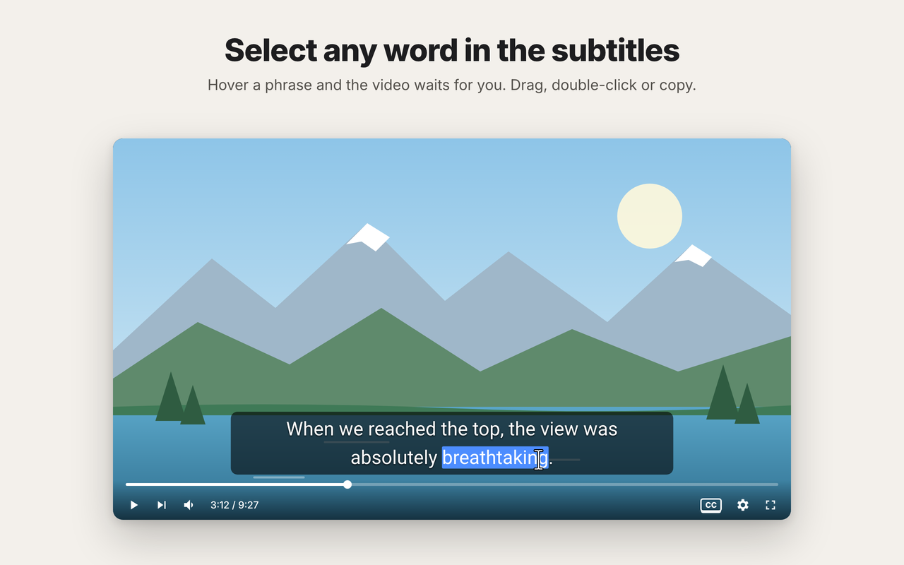

# Selectable Subtitles for YouTube

A Chrome extension that turns YouTube subtitles into plain text you can select, copy and right-click. Hover a phrase to keep it on screen.

[Русская версия](README.ru.md) · [Privacy policy](PRIVACY.md)

YouTube draws captions in a way you can't select or copy. The extension shows them in its own box inside the player, so you can highlight a word, copy a phrase, or right-click it and use any dictionary extension you already have. It works with any caption language, including right-to-left ones such as Hebrew.

## Install from source

1. Open `chrome://extensions`.
2. Turn on **Developer mode** (top right).
3. Click **Load unpacked** and choose this folder.
4. Reload the YouTube tab.

## How to use

- Turn on captions in the player (the CC button).
- Hover a phrase. The video keeps playing while the phrase is spoken and pauses right before the next one, so the phrase stays on screen.
- Select words with the mouse: drag, double-click a word, or triple-click the whole phrase.
- Right-click to open the normal Chrome menu with your other extensions.
- Move the mouse away and the video continues.
- Drag the box by its handle (⠿) to move it. The position is remembered for all videos. Double-click the handle to put it back.

## Settings

Click the extension icon in the Chrome toolbar:

- **Text size**: 50% to 200%. The text also scales with the player, so it is larger in full screen.
- **Background**: how dark the box behind the text is, from 0% to 100%.
- **Hold phrase during pauses**: keep a phrase on screen until the next one starts (on by default).
- **Reset position** and **Reset all**.

Changes apply to open YouTube tabs at once.

## How it works

- `page-hook.js` runs in the page and receives the caption file that the YouTube player itself downloads.
- `content.js` builds phrases from that file and shows them in time with the video. Auto-generated captions are joined into whole sentences by punctuation and speaker changes (`>>`); author-uploaded captions keep the author's phrasing. If the file can't be read, the box mirrors YouTube's own captions as they appear.
- `popup.html` / `popup.js` is the settings window; `settings.js` holds the defaults shared by both.

## Privacy

The extension collects no data. It has no account, no analytics and sends nothing anywhere. Settings are stored locally in Chrome. It runs only on youtube.com. See [PRIVACY.md](PRIVACY.md).

## License

[MIT](LICENSE)

Selectable Subtitles for YouTube is an independent project and is not affiliated with or endorsed by YouTube or Google.
